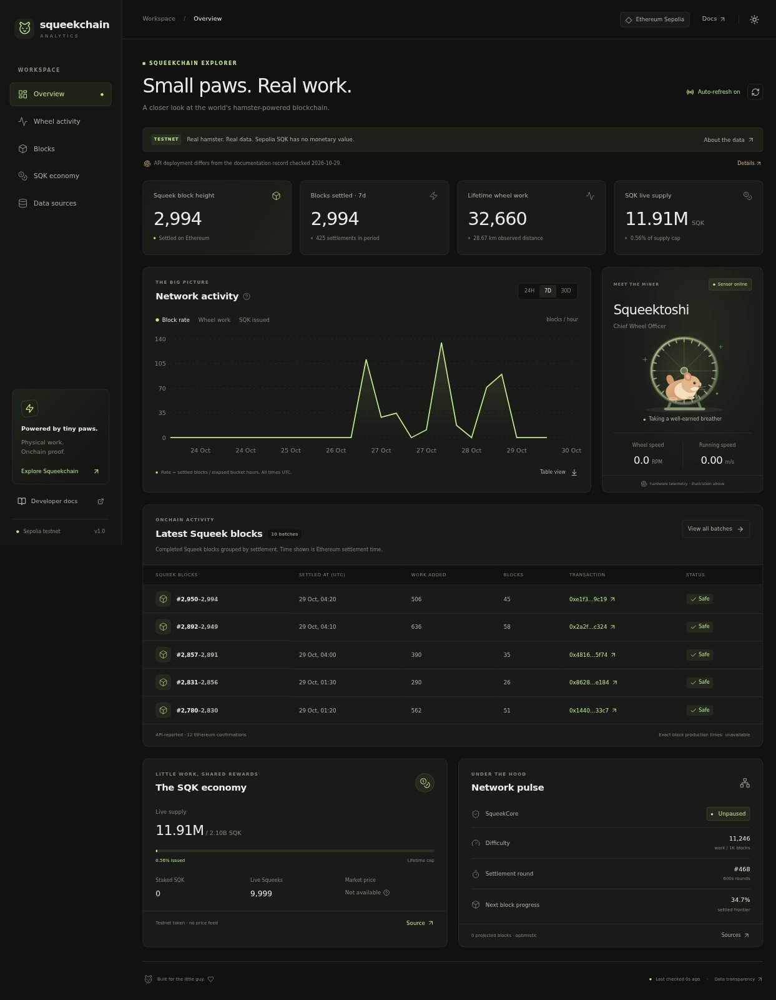

# Squeekchain Analytics

**Small paws. Real work.** An independent analytics dashboard for the hamster-powered Squeekchain ecosystem on **Ethereum Sepolia**.

Public source: [Volha1213/squeekchain-analytics](https://github.com/Volha1213/squeekchain-analytics). Vercel production deployment is not yet published.

Built with **Next.js 16, TypeScript, Tailwind CSS 4, and Recharts**. No wallet, API key, database, or paid RPC provider is required.



*Real API data captured on 2026-10-29. The screenshot is documentation; runtime data is always fetched from the official API.*

## Features

- Live WHEELY9000 telemetry: wheel RPM, running speed, sensor freshness, hardware provenance, and active/idle/fault states.
- Settled Squeek block height, work, difficulty, settlement rounds, and next-block progress.
- Latest block-completing settlement batches with real Sepolia transaction links.
- Interactive block settlement rate, wheel work, and SQK issuance charts, with period selection, accessible table view, and CSV export.
- Historical accepted wheel activity, distance, records, and observation coverage.
- SQK live supply, lifetime supply cap, mining issuance, staking totals, and live Squeek counts.
- Responsive mobile navigation, dark/light themes, reduced-motion support, and keyboard controls.
- Automatic refresh every 15 seconds while visible, a pause switch, and manual refresh.
- Source status, timestamps, cache provenance, schema validation, and deployment identity transparency.

## Run locally

Use **Node.js 24.x** and npm. The Node major version is pinned in `package.json` and `.nvmrc` to keep local, CI, and Vercel environments consistent.

```bash
npm ci
npm run dev
```

Open http://localhost:3000. No environment configuration is required; `.env.example` documents this intentionally empty configuration.

```bash
npm test             # Data precision, real source fixtures, failure handling, cache behavior
npm run typecheck    # Strict TypeScript checks
npm run check:sources # Live official API checks; requires internet
npm run build        # Production build, including TypeScript validation
npm start            # Serve the production build
```

The production build does not require the upstream API to be online. Data is requested at runtime.

## Real data, with explicit limits

Source: [official API reference](https://docs.squeekchain.com/developers/api/).

| Official endpoint | Used for | Server cache |
| --- | --- | --- |
| `GET https://api.squeekchain.com/v1/status` | Device readings, freshness, optimistic projection | 5 seconds |
| `GET https://api.squeekchain.com/v1/core` | Settled SqueekCore state | 15 seconds |
| `GET https://api.squeekchain.com/v1/settlements?range=24h`, `7d`, or `30d` | Block batches, settlement rate, period issuance | 60 seconds |
| `GET https://api.squeekchain.com/v1/economy/state` | SQK supply and staking | 15 seconds |
| `GET https://api.squeekchain.com/v1/measurement/stats?range=7d` or `30d` | Historical activity and coverage | 5 minutes |

The same-origin `/api/analytics?range=7d` route aggregates these fixed read-only URLs. Ranges `24h`, `7d`, and `30d` are accepted; unknown or repeated query parameters return HTTP 400. Measurement statistics support only `7d`/`30d`; wheel activity therefore offers those two ranges.

### Integrity rules

- Official JSON Schemas are vendored in `src/lib/schemas/`, retrieved on 2026-10-29. AJV validates schema version, required fields, ranges, timestamp formats, and unsigned integer sizes. Unknown additive properties are accepted as specified by the API's versioning contract. Unknown breaking versions and invalid responses become explicit source errors.
- HTTP 200 with `status: "unavailable"` is unavailable, never zero. Each source fails independently. A failed dashboard refresh retains the last snapshot with a visible stale-data message. Device readings become stale after the reported freshness threshold, including while refresh is paused.
- ETags and 304 responses preserve the original data generation time. `Retry-After` is respected; upstream errors back off for at least 15 seconds. Requests are coalesced within a server instance. Network requests time out after 8 seconds.
- SQK is parsed as `BigInt`. Full amounts retain 18-decimal precision. Compact values truncate; chart values convert at the presentation boundary and are approximate. Integers exceeding safe chart precision become gaps.
- Wheel work measures accepted magnet passages, not hashes, energy, or health. Historical distance and live device-day distance are different observations.
- **Block rate means blocks settled per elapsed hour in an API bucket.** It is not the exact time between physical block completions. Current partial buckets use elapsed time through the source's `generatedAt`; future buckets are gaps.
- Latest blocks are grouped by their real settlement transaction. Displayed timestamps are Ethereum settlement times, not individual block production times.
- Missing wheel observations are gaps. Partial days display their coverage. Device days start at **12:00 UTC**, following the source contract.
- A `durable-cache` settlement response is visibly marked as an upstream cached snapshot.
- Market price, market cap, trading volume, TPS, validators, and exact individual block production times are not invented. Sepolia SQK is a testnet asset with no monetary value.
- The hamster graphic is an original SVG illustration. It is labeled as an illustration; it is not a live camera feed. The wheel animates only when fresh telemetry reports an active wheel.

### Deployment record discrepancy

On **2026-10-29**, the current API reported a different Core and SQK deployment from the [published deployment record](https://docs.squeekchain.com/assets/deployments/sepolia.json):

| Contract | Published record snapshot | Live API at research time |
| --- | --- | --- |
| SqueekCore | `0x74665dAecA35A2303e767E76a2FF1FB6F93e119f` | `0x980b4424c007caf7a1f3670b48c8eaef7ebc3d44` |
| SQK | `0x6872bfa5ccc3e9e440c6c16e5ffdabb8dba4cc76` | `0x5501e1fa81be1c3f49225fa7668da0245d07db60` |

The application makes this discrepancy visible. The snapshot is stored with its source URL and retrieval date in `src/lib/deployment-record.json`; it is **not a dynamically refreshed deployment registry**. The app compares current Core/economy chain IDs and Core addresses for internal consistency, but this is **not independent RPC verification**. All figures remain explicitly API-reported. Refresh the snapshot after reviewing an updated official deployment record.

## RPC and SDK research

Squeekchain is an application on Ethereum Sepolia (chain ID `11155111`), not a separate EVM network. The [official quickstart](https://docs.squeekchain.com/developers/quickstart/) uses **viem 2** and a user-supplied Sepolia RPC with historical reads. The [developer documentation](https://docs.squeekchain.com/developers/) publishes contract ABIs and deployment identities; it does not supply a dedicated runtime SDK. The [agent skill](https://docs.squeekchain.com/developers/build-with-ai/) is developer guidance, not an application SDK.

This application uses the documented public API. It does not guess a Squeekchain RPC URL, use an unverified contract ABI, sign transactions, or imply it has verified contract identities onchain. An independently verified RPC integration would first need to resolve the deployment discrepancy and follow the official identity verification procedure.

## Deploy to Vercel

1. Push this standalone project to your GitHub repository using the instructions below.
2. In [Vercel](https://vercel.com/new), import that repository.
3. Select **Next.js**, set the root to the repository root, and choose **Node.js 24.x**. The checked-in `vercel.json` declares the framework and install/build commands.
4. Keep the standard commands: install `npm ci`, build `npm run build`, and the default Next.js output directory. No environment variables are required.
5. Deploy, then open `/api/analytics?range=7d` and the **Data sources** screen to confirm current upstream availability.

Alternatively, from the project directory, run `npx vercel` and, once you have reviewed the preview, `npx vercel --prod`. These require your Vercel account and authentication.

The route runs on the Node.js runtime with a 30-second maximum duration. Source calls run concurrently. Caches are in-memory and **per instance**; separate serverless instances/cold starts do not share request budgets. Upstream Cloudflare caching still applies. For high traffic, add a shared cache/limiter appropriate to your hosting plan. The application does not require persistent storage for normal use.

## Publish to GitHub

This folder is an independent Git repository on branch `main`. Build output, dependencies, local environment files, and Vercel state are ignored. CI checks tests and the production build.

Create an empty GitHub repository named `squeekchain-analytics`, then run:

```bash
git remote add origin https://github.com/YOUR_GITHUB_USERNAME/squeekchain-analytics.git
git push -u origin main
```

Replace `YOUR_GITHUB_USERNAME` with your actual account. If you make further changes before pushing:

```bash
git add .
git commit -m "Update Squeekchain analytics"
```

No GitHub repository, owner identity, or deployed public URL is fabricated in this source tree.

## Buildooooor / Early Buildooooor

The official [Aura badge listing](https://squeekchain.com/genesis/aura) describes project submission with verified attribution as the Buildooooor requirement. Early Buildooooor depends on being among the first 88 members to verify a project. Building or deploying this code does not itself award either badge.

See [the researched submission requirements](docs/BUILDERS.md), [authorship evidence](docs/AUTHORSHIP.md) and [English submission draft](docs/SUBMISSION.md). At the time of research, Genesis marked Code as not open yet. Bundled, currently inactive submission guidance describes DNS attribution and excludes read-only dashboards. This application is read-only; acceptance must be confirmed by the team. No badge eligibility or award is claimed.

## Structure

```text
src/app/                  Next.js layout, dashboard page, API route, themes
src/components/           Interactive dashboard, chart, SVG illustration, polling hook
src/lib/sources.ts        Fixed official source reads, validation, ETag/cache/backoff
src/lib/validate.ts       Official JSON Schema validation
src/lib/format.ts         Exact integer/token formatting and chart boundaries
src/lib/schemas/          Upstream official JSON Schema snapshots
src/lib/deployment-record.json  Dated official deployment record snapshot
tests/                    Data integrity and failure-handling regression tests
tests/fixtures/            Recorded real API responses; never used at runtime
scripts/check-sources.ts  Live endpoint and schema checks
docs/BUILDERS.md           Publication and badge submission checklist
```

This is an independent community project. It is not an official Squeekchain product. Application code is MIT licensed; upstream schema snapshots retain their upstream provenance.

## Public release verification

After deployment, run the anonymous checks with the actual URLs:

```bash
npm run check:publication -- --site https://YOUR_PUBLIC_HOST --repository YOUR_GITHUB_USERNAME/squeekchain-analytics
```

This checks anonymous HTTPS access, schema-valid analytics, error routes, non-exposure of environment/Git files, and public GitHub `main`. It rejects BB share URLs. Browser checks of the five dashboard views and mobile layout remain required. See [the security review](docs/SECURITY.md) for the source/history audit.

Only the reviewed `esbuild@0.28.2` install script is approved in `package.json`; this removes npm's pending-script warning without approving scripts for unrelated or future package versions.
